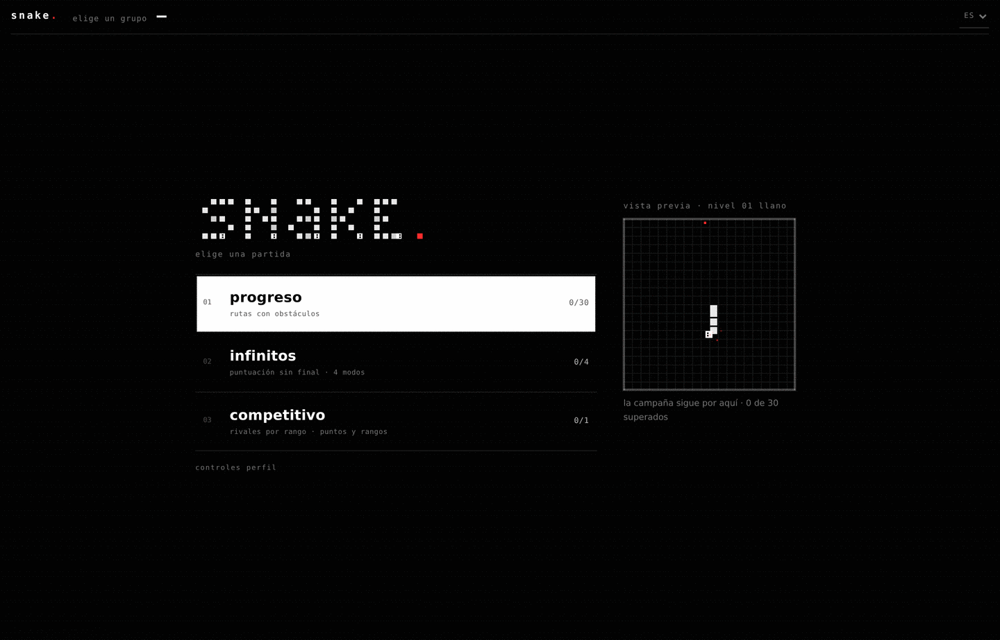
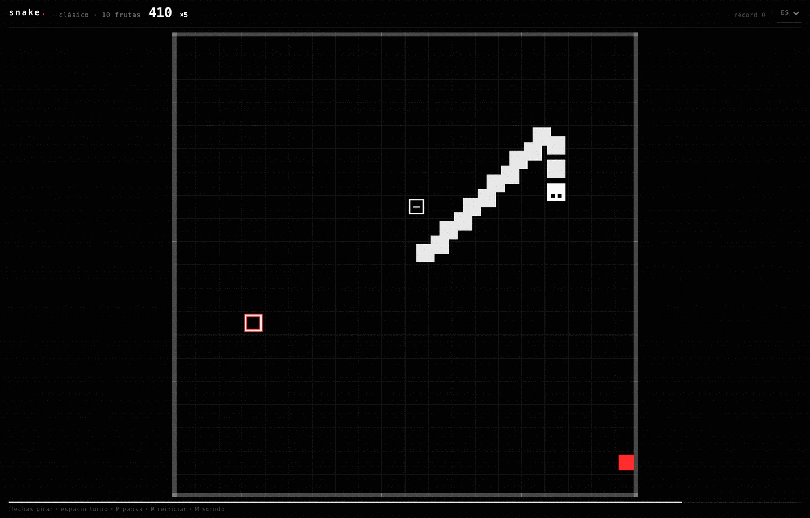
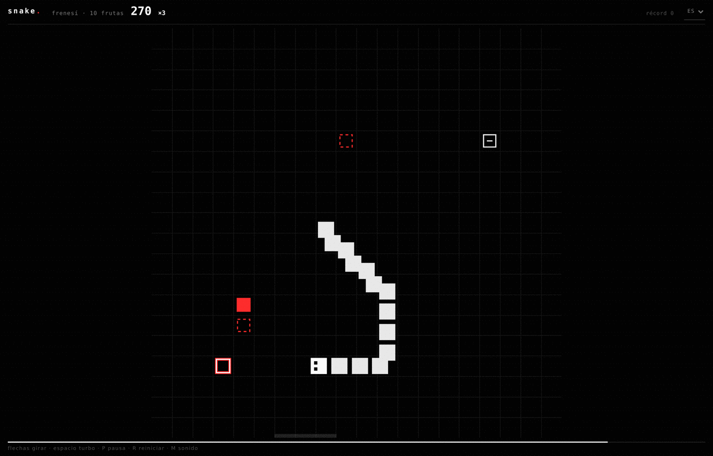
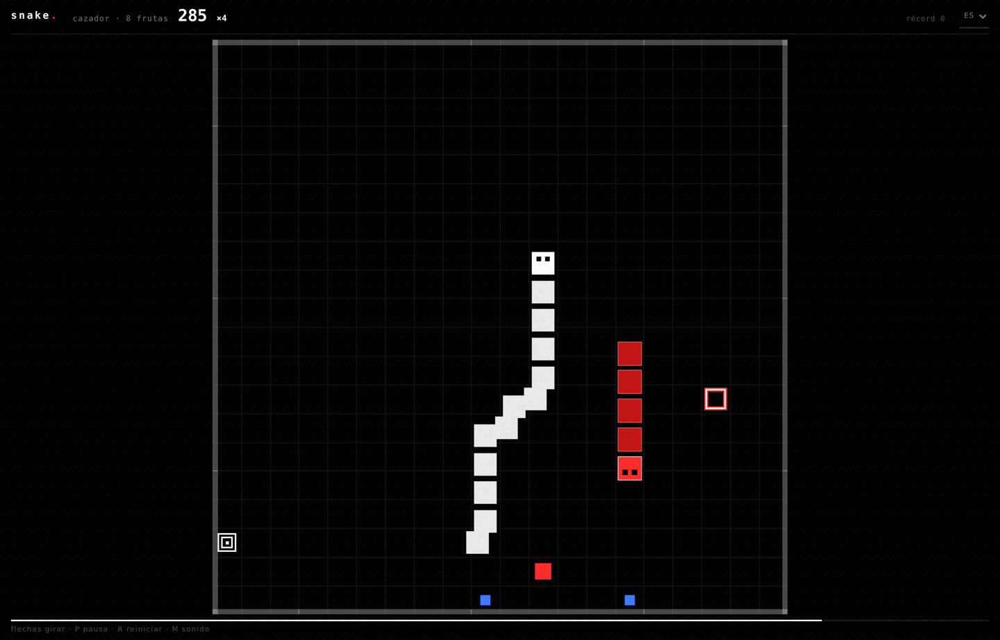
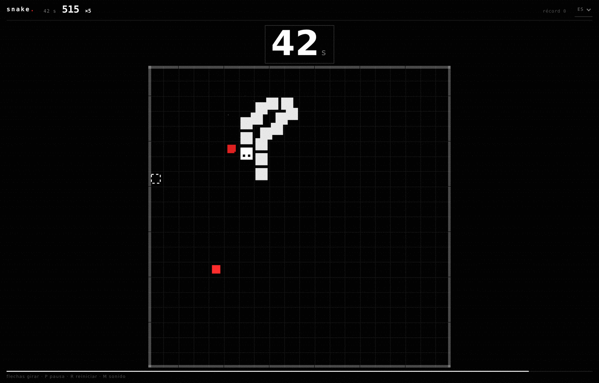
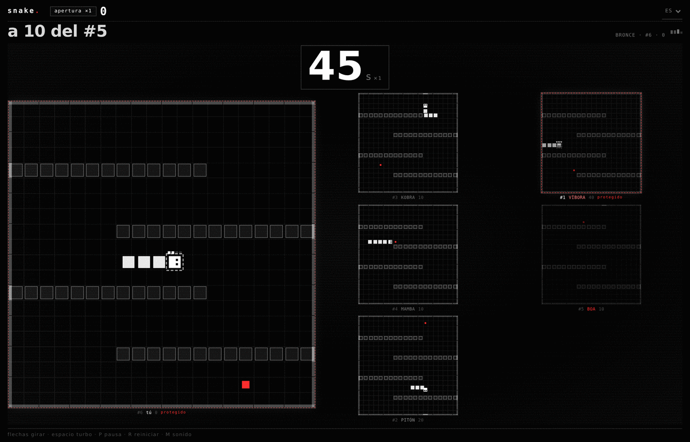
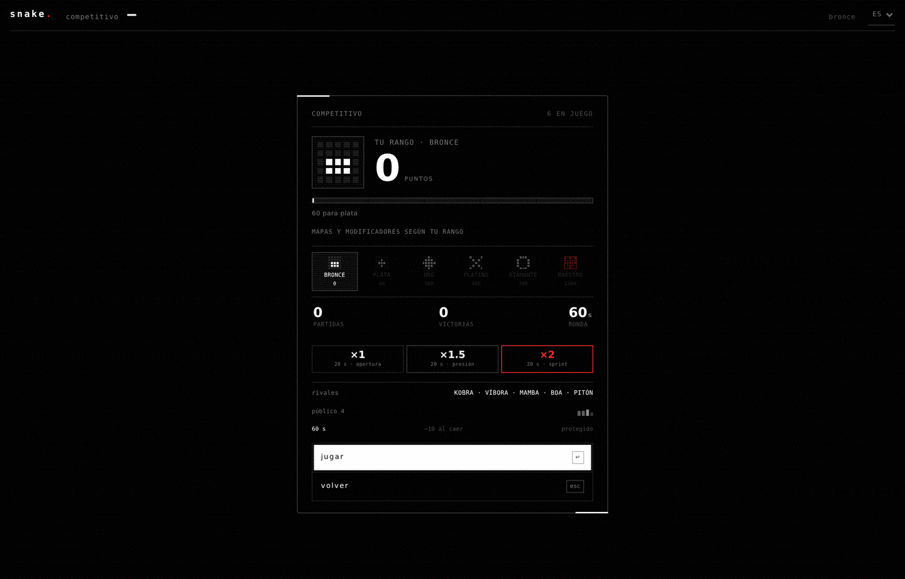
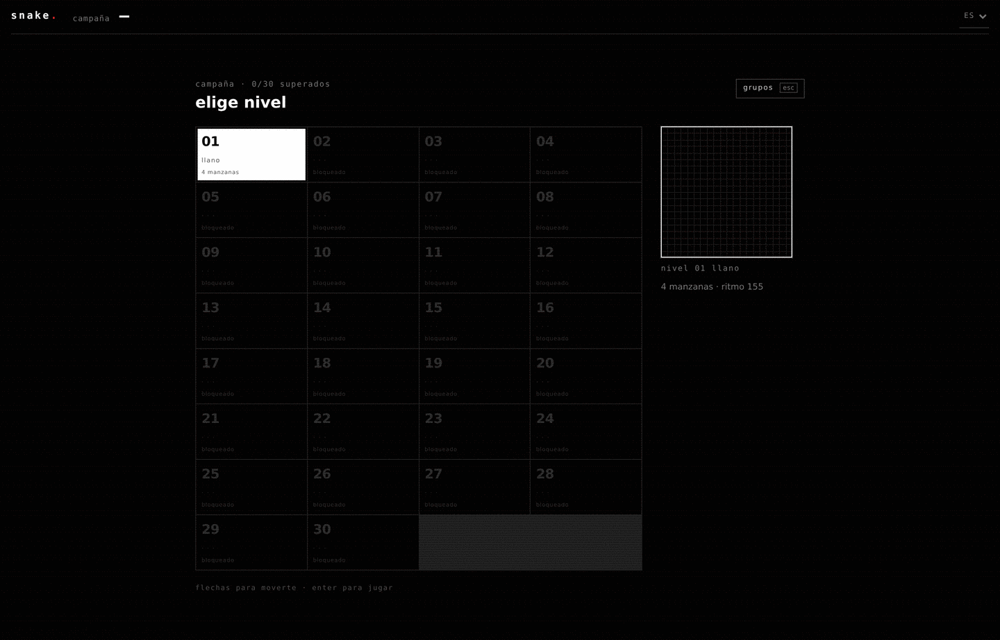
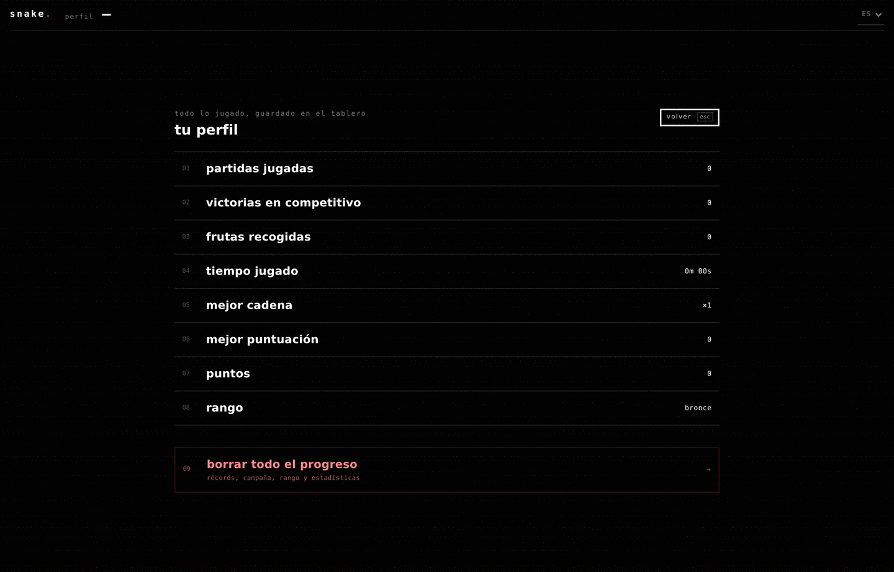

# snake

Un juego de serpientes de bloques en blanco y negro. Sin adornos, sin dependencias y sin llamadas a la red: sólo la rejilla, la manzana, el pulso de los bloques y el ruido seco de cada choque. La interfaz está en español y en inglés, y se puede jugar con teclado, gesto táctil o mando.



**Juega en [snake.jaime-gaming.com](https://snake.jaime-gaming.com)** · [Cómo ejecutarlo en local](#ejecutar-en-local) · [Capturas](#capturas) · [Controles](#controles) · [Modos](#modos) · [Competitivo](#competitivo)

## Ejecutar en local

El juego no tiene dependencias, ni instalación, ni compilación. En el repositorio ya está el bundle `snake.js`, así que basta con abrir `index.html`.

Node.js **20 o superior** sólo hace falta para el servidor de desarrollo y para las comprobaciones; para jugar no se necesita nada.

### Opción rápida: abrir la página

Descarga el repositorio y abre `index.html` con doble clic. La página detecta que viene de `file://`, usa rutas relativas y funciona sin servidor. El audio arranca en la primera interacción, como en cualquier navegador.

### Opción recomendada: servidor de desarrollo

```sh
git clone https://github.com/jaime-gaming/snake.git
cd snake
node serve.mjs          # http://localhost:8123
node serve.mjs 3000     # o el puerto que quieras
```

`serve.mjs` sirve el sitio **sin caché** (para no mirar CSS viejo), devuelve `index.html` en las rutas profundas (`/competitivo`, `/campaña/nivel-30`…) y entiende las URLs antiguas bajo `/snake/`. También escucha en `0.0.0.0`, así que se puede abrir desde el móvil con la IP del ordenador.

Cualquier otro servidor estático vale igual, siempre que las rutas desconocidas caigan en `index.html`:

```sh
python3 -m http.server 8000
npx serve .
```

### Comprobaciones

```sh
node tools/check.mjs           # reglas, niveles y textos; sin navegador
node tools/build.mjs           # regenera snake.js a partir de js/*.js
node tools/build.mjs --check   # falla si snake.js no coincide con las fuentes
```

`snake.js` es un **artefacto generado**: no se edita a mano. Los cambios van en `js/*.js` y después se ejecuta `node tools/build.mjs`. El mismo par de comandos es lo que corre la CI en cada `push` y en cada *pull request* (`.github/workflows/checks.yml`).

### Estructura

| Ruta | Qué es |
| --- | --- |
| `index.html` | la página: la barra, el lienzo, el reloj y los avisos |
| `styles.css` | toda la estética de bloques |
| `snake.js` | bundle generado que carga la página |
| `js/` | fuentes del juego: `engine`, `levels`, `audio`, `input`, `i18n`, `grid`, `main` |
| `tools/` | `build.mjs`, `check.mjs` y `verificar-despliegue.mjs` |
| `media/` | las capturas de este README |

## Capturas

| | |
| --- | --- |
|  |  |
| **Clásico** — cada fruta acelera y a las treinta llegan los muros. | **Frenesí** — bordes abiertos, olas de fruta y picos de velocidad. |
|  |  |
| **Cazador** — la serpiente roja come puntos azules y después te busca. | **Contrarreloj** — treinta segundos que aceleran; cada fruta suma tres. |
|  |  |
| **Competitivo** — seis tableros a la vez, tres actos de veinte segundos. | **Menú del competitivo** — rango, puntos y qué abre cada peldaño. |
|  |  |
| **Campaña** — treinta niveles y la vista previa del elegido. | **Perfil** — lo jugado, los récords y el rango actual. |

## Idea visual

La pantalla es una hoja de tinta: negro profundo, blancos duros y un rojo reservado para lo que quema. La serpiente no es una línea continua, sino una cadena de bloques que respira con la manzana. El título de la portada está dibujado como cinco serpientes independientes; la `e` persigue la manzana despacio, sin prisa, hasta alcanzarla. Los marcos son escuetos, las esquinas se marcan con dos trazos y cada aviso ocupa el menor espacio posible. La tipografía mezcla texto sin serifa para leer con comodidad y monoespaciada para cifras y rótulos; los datos siguen alineados como bloques.

El rojo no es decoración: anuncia la manzana envenenada, la serpiente cazadora y el borde que apura el reloj. La manzana envenenada no grita: comparte tamaño, brillo y respiración con la buena; sólo la delatan un rojo algo más oscuro y una muesca mínima en la esquina inferior derecha.

## Controles

| Acción | Teclado | Táctil / mando |
| --- | --- | --- |
| Girar | Flechas o WASD | Deslizar / cruceta o stick |
| Turbo | Espacio o Mayús | Tocar el tablero / botón A; no existe en Cazador ni en los niveles sin turbo |
| Pausa | P o Esc | Start |
| Reiniciar | R | — |
| Sonido | M | — |
| Menús | Flechas, Av Pág/Re Pág, Inicio/Fin y Enter | Elegir una opción |

Los paneles largos se recorren con la rueda, con el gesto táctil y con el teclado; el foco siempre queda a la vista. En la rejilla de niveles, `↑↓` cambian de fila. La barra superior no lleva botones: pausa y sonido viven en el teclado y en los ajustes.

## Modos

La portada agrupa el juego en tres rutas: **progreso**, **infinitos** y **competitivo**.

- **Campaña** — Treinta niveles dibujados a mano. Cada manzana abre el siguiente; no hay puntuación, sólo manzanas recogidas y las que faltan. Algunos niveles añaden un modificador: muros que aparecen, un reloj, la ausencia de turbo o la entrada del cazador.
- **Clásico** — Sin final. Cada fruta acelera la serpiente y, a partir de la trigésima, empiezan a salir muros. La manzana envenenada no existe aquí: todo es ritmo y espacio.
- **Frenesí** — Los bordes se abren y la serpiente gana velocidad poco a poco. Cada dieciséis segundos cae una ola de tres frutas extra, que parpadean antes de irse, y cada once segundos un pulso de velocidad aprieta el tablero. La manzana envenenada aparece de vez en cuando.
- **Cazador** — Una serpiente roja come puntos azules y después te busca. Su cabeza mata; su cuerpo y sus puntos son seguros. Si choca contigo, estalla y vuelve más corta. Tú también puedes comer los puntos azules. Aquí no hay veneno.
- **Contrarreloj** — Empiezas con treinta segundos en un reloj grande sobre el tablero. Cada fruta suma tres segundos, pero el reloj acelera hasta el doble; el potenciador *lento* lo frena a la mitad, el turbo queda apagado y, bajo diez segundos, el reloj se vuelve rojo y parpadea. Una segunda manzana, lejos de la buena, va envenenada: comerla cuesta cinco segundos y corta la cadena.

Los potenciadores cambian según el modo:

- **Campaña:** fantasma, lento y encoger.
- **Clásico:** fantasma, lento, encoger y doble puntuación.
- **Frenesí:** lento, escudo y doble puntuación.
- **Cazador:** fantasma, encoger y escudo.
- **Contrarreloj:** lento, escudo, doble y fantasma.
- **Competitivo:** fantasma, escudo, lento y encoger. Los rivales también los recogen.

El fantasma atraviesa peligros; el lento baja la velocidad y tiñe la serpiente de azul, un color que se apaga solo mientras dura el efecto; encoger acorta la cola; el escudo perdona un choque; el doble multiplica los puntos. Al comer la manzana envenenada el cuerpo se vuelve verde unos segundos y después recupera su blanco.

## Competitivo

Una partida de **sesenta segundos** en **tableros separados**, uno por serpiente: tú y tus rivales. En bronce son cinco rivales; el número sube con el rango hasta siete en diamante y maestro. No comparten casillas ni fruta. Tu tablero es el más grande y va enmarcado en blanco; cada tablero lleva su nombre, sus puntos y su puesto. El líder lleva un marco propio y un pulso lento; tu marco queda encendido todo el rato y un choque lo enciende en rojo un instante. El acto se lee en la barra superior y la ventaja en una **banda grande** justo debajo: «lideras» o la distancia al rival que va delante, con el puesto, los puntos y el rango al lado. No hay carteles que tapen la partida ni avisos repetidos por cada adelantamiento. La luz del escenario se cruza entre actos —el halo blanco se apaga mientras entra el rojo— y la grada crece con tu rango: cuanto más alto, más bloques de público y más peso tiene la luz de la recta final.

La partida tiene **tres actos de veinte segundos**: apertura a ×1, presión a ×1.5 y sprint final a ×2. El cambio de acto se marca con un destello breve en la barra, no con un cartel sobre el juego. Guardar los riesgos para el último acto es una decisión real. Al chocar se pierden diez puntos y la serpiente vuelve a los 0,8 segundos con 1,8 segundos de gracia: durante ese tiempo atraviesa muros y cuerpos, y el borde da la vuelta en vez de matar. Cuatro bloques sobre su cabeza cuentan la gracia que queda.

Antes de jugar hay un menú con el rango, los puntos, la escalera completa y los rivales. Después se sortean el mapa y el modificador, la ruleta gira, se fija el resultado y una cuenta atrás de tres segundos arranca todos los tableros. Los rivales se mueven exactamente a tu velocidad, en tu mismo mapa y con tu mismo modificador; lo que cambia por dentro es su lectura del tablero, nunca una barra de fuerza a la vista.

### Rangos

El puesto reparte puntos: 1.º +25, 2.º +10, 3.º +5 y del 4.º en adelante +0. Además, el marcador de la partida deja una bonificación mínima: un punto extra por cada 250 puntos conseguidos, con un tope de tres. Los puntos suben por seis peldaños y **cada peldaño pide más que el anterior**:

| Rango | Puntos | Lo que se abre |
| --- | --- | --- |
| Bronce | 0 | Mapas amplios y muros |
| Plata | 60 | Entra el reloj |
| Oro | 180 | Entra el cazador |
| Platino | 400 | Entra la ausencia de turbo |
| Diamante | 700 | Entra el veneno y los mapas cerrados |
| Maestro | 1200 | El repertorio completo, en su versión más dura |

Cada peldaño tiene su propia figura de bloques; al subir de rango, el resultado compara el icono viejo con el nuevo, hace saltar sus bloques en cascada, lanza chispas y barre una luz por la franja, una sola vez. La escalera no es sólo una cifra: **los mapas y los modificadores suben contigo**. En bronce se juega en mapas abiertos y con muros; al ascender se abren laberintos más cerrados, entran el reloj, el cazador, la ausencia de turbo y el veneno, el reloj arranca con menos margen, el cazador ve más lejos y los muros salen antes y con más frecuencia. Todos los tableros reciben siempre el mismo mapa, el mismo modificador y la misma velocidad.

## Perfil

La portada enlaza con el perfil: partidas, victorias en competitivo, frutas, tiempo jugado, mejor cadena, mejor puntuación, puntos de rango y el peldaño actual. Al final hay un botón para **borrar todo el progreso** —récords, campaña, rango y estadísticas— con confirmación; el ajuste de borrado hace lo mismo.

## El hub

El juego cuelga del hub de la casa, [classic.jaime-gaming.com](https://classic.jaime-gaming.com). Quien llega desde allí —con `?from=hub` en la dirección, en la portada o en cualquier ruta profunda— encuentra en la portada un botón blanco **«← volver al hub»**, arriba a la izquierda, justo bajo la barra superior; lleva a `https://classic.jaime-gaming.com/?from=snake`. El parámetro se limpia de la barra de direcciones y el origen se recuerda en `sessionStorage`: el botón sigue ahí al recargar o al pasear por los menús y desaparece al cerrar la pestaña. Quien entra directo no lo ve. También se alcanza con las flechas (arriba desde el primer grupo) y Enter.

## Idioma

El selector **EN / ES** cambia todos los textos y recuerda la elección. La estética no cambia con el idioma: los mismos bloques, los mismos silencios y el mismo rojo.

## Despliegue

La publicación en el dominio, la caché y la comprobación posterior están en [DESPLIEGUE.md](DESPLIEGUE.md).

## Contribuir

Los arreglos y las ideas son bienvenidos. Antes de abrir un *pull request*:

```sh
node tools/check.mjs
node tools/build.mjs          # si has tocado js/*.js
node tools/build.mjs --check   # debe decir «snake.js al día»
```

- Toca `js/*.js`, nunca `snake.js`, y regenera el bundle en el mismo cambio.
- Si cambias `styles.css` o `snake.js`, sube el sello `?v=` de `index.html` (y la comprobación de `tools/check.mjs`) para que nadie vea una copia vieja.
- Las comprobaciones de `tools/check.mjs` son estrictas a propósito: cubren modos, rangos, idioma y textos. Si una falla, arregla el código o justifica por qué la comprobación cambia.
- Los textos de la interfaz van **en español y en inglés** en `js/i18n.js`; una cadena sin su pareja deja la mitad del juego en el otro idioma.

No hay plantilla de *issue* ni código de conducta: abre un *issue* o un *pull request* contando qué cambia y por qué.

## Licencia

[MIT](LICENSE) © 2026 Jaime Gaming. Es la misma licencia que usa [Wave](https://github.com/jaime-gaming/Wave).
